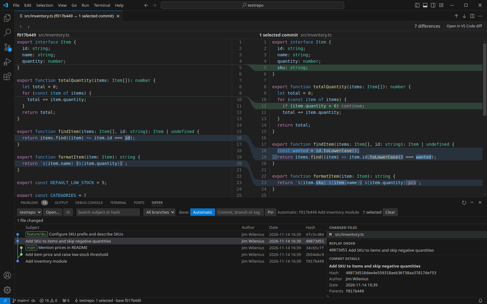
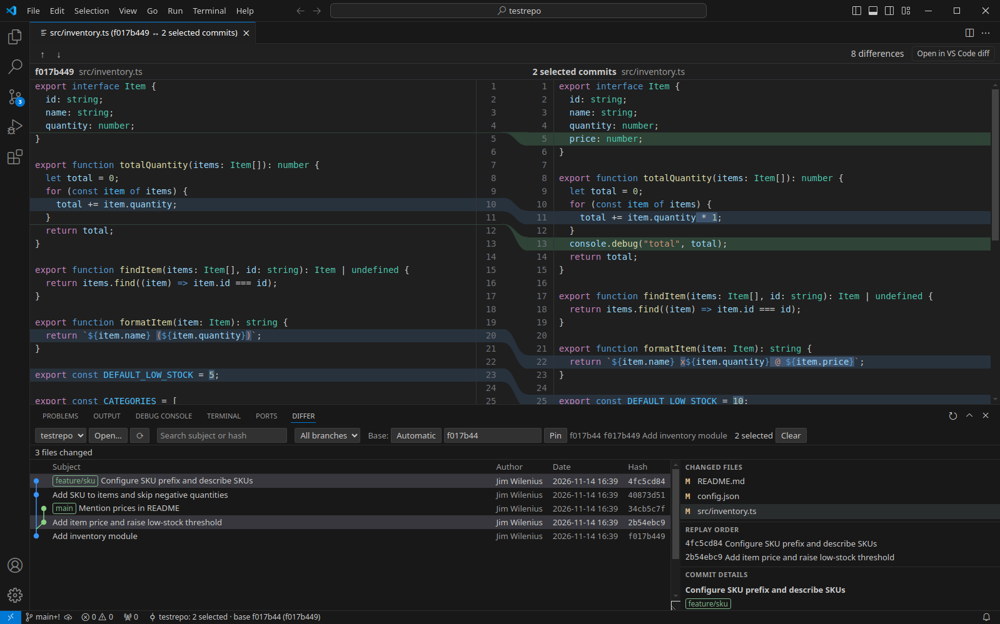
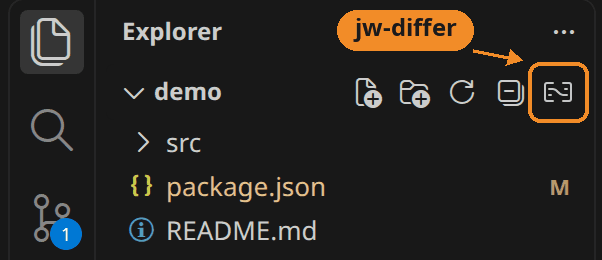
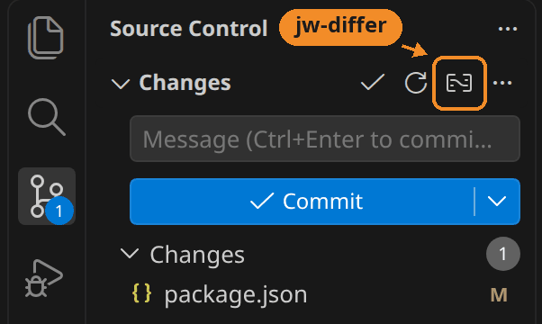
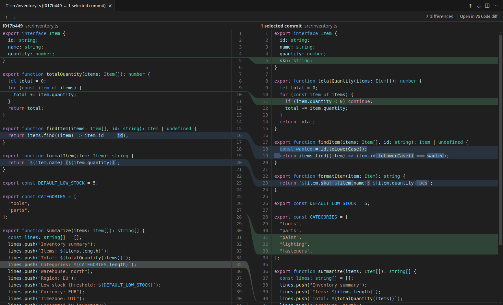
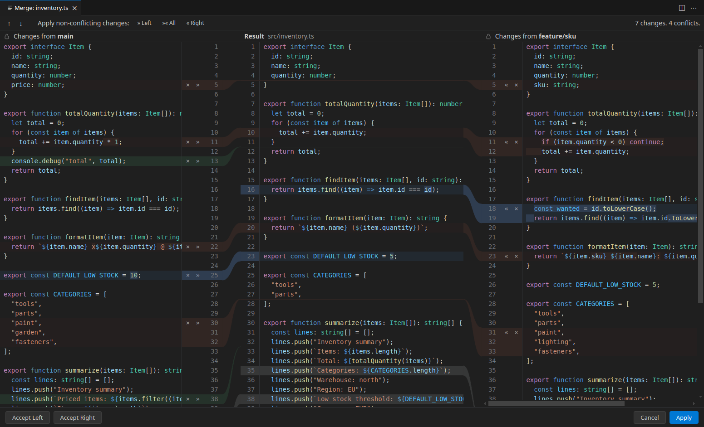
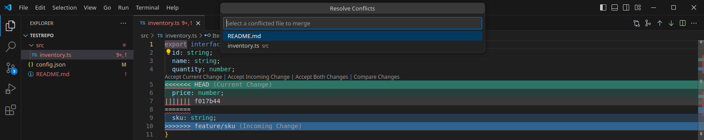
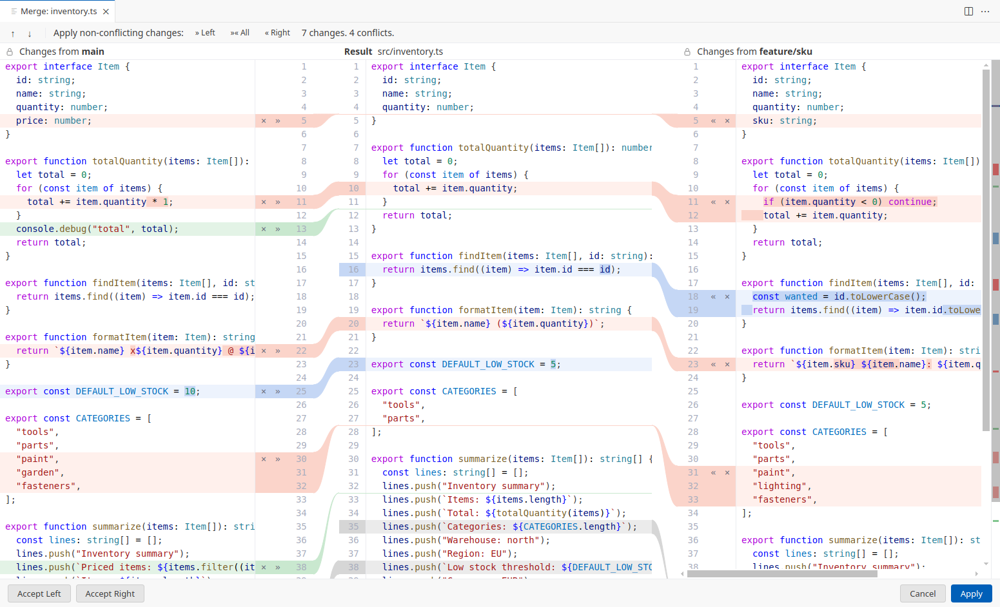
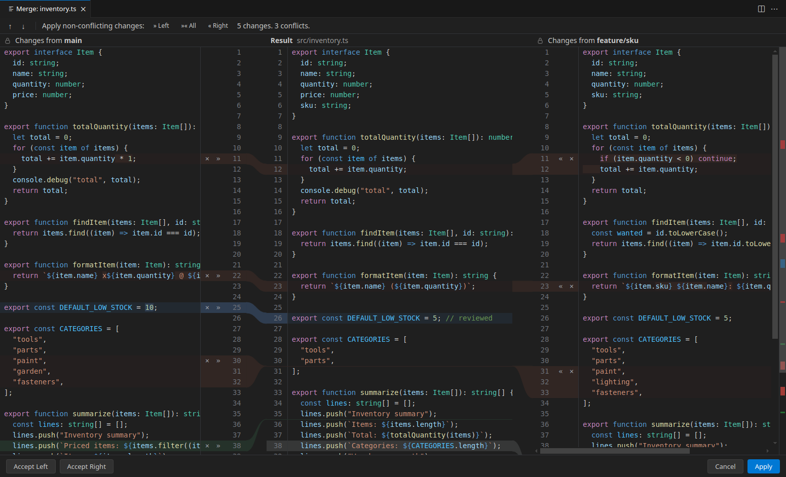

# jw-differ

> [!NOTE]
> This was 100% vibe-coded, but the vibes were heavily curated; Claude on a leash.

_jw-differ is short for "just-working-differ" or "jim-wilenius-differ" — take your pick._

IntelliJ-style Git commit diff viewer and three-way merge conflict resolver for VS Code.

Two workflows: review the combined changes of any set of commits, and resolve merge conflicts.

## Git commit history and diff viewing

Select any subset of commits — including non-adjacent ones — and see exactly what those commits change, with nothing
from the commits in between. Double-click a file to open its diff in VS Code's native diff editor.



_Git History panel: branch graph, commit table, changed files, replay order and details; the selected commit's diff
open above._



_Multi-commit selection: two non-adjacent commits on different branches, Ctrl+clicked, replayed onto a pinned base;
the diff shows only their changes, nothing from the commits between them._

### Opening it

 

_The jw-differ history button in the Explorer's folder header (left) and Source Control's **Changes** header
(right)._

- Click the jw-differ button (two panes joined by a ribbon) in the Explorer's folder header or the Source Control
  header (Git repositories), run **jw-differ: Open Git History**, or open the **jw-differ** tab in the bottom panel.
  **jw-differ: Refresh Git History** (also the ↻ button in the view title) reloads commits and refs.
- The header buttons open the bottom panel and leave the side bar alone: it keeps showing the Explorer or Source
  Control. jw-differ adds no Activity Bar icon. Like other buttons in a section header (the Explorer's folder, or
  Source Control's **Changes** on newer VS Code), they show while the pointer is over the side bar unless
  `workbench.view.alwaysShowHeaderActions` is on.
- The repository comes from the active editor and the workspace folders; the picker switches between them, and
  **Open…** adds any local repository folder. Each repository keeps its own selection and base for the session.
- The status bar shows `<repository>: N selected · base …` and reopens the panel when it is hidden. Hiding and
  reopening the panel keeps the selection, base and filters.

### Selecting commits

Layout follows IntelliJ's Git Log: branch graph and commit table (subject, branch/tag labels, author, date, hash) on
the left; changed files, replay order and commit details on the right.

| Gesture                         | Effect                                              |
| ------------------------------- | --------------------------------------------------- |
| Click                           | Select only that commit                             |
| Ctrl/Cmd+click                  | Add or remove one commit                            |
| Shift+click                     | Select the shown range from the last clicked commit |
| Ctrl/Cmd+Shift+click            | Add that range to the selection                     |
| `↑` / `↓`                       | Move focus; details update when you pause           |
| Shift+`↑` / Shift+`↓`, Space    | Extend the selection / toggle the focused commit    |
| **Clear**                       | Deselect everything                                 |
| Double-click or `Enter` on file | Open its diff (base ↔ result) in the editor         |

- **Search** filters by subject or hash (literal, case-insensitive); the branch filter shows commits reachable from
  that branch. Filtering never changes the selection — selected commits it hides are counted next to the selection.
- The branch filter starts on **Checked out branch** (each worktree's own, named in the option), which follows HEAD on
  every load and refresh: a new commit, or checking out another branch, moves it along. While HEAD is detached it shows
  HEAD's commit history, labelled **Checked out (detached HEAD)**; while HEAD is older than the loaded commits it shows
  all branches. A branch you pick, or **All branches**, is kept per repository for the session and follows that branch
  as it moves; if the branch is deleted or no longer loaded, it shows all branches. Pick **Checked out branch** to
  follow HEAD again.
- Click the branch filter (or focus it and press `Enter`, `Space` or `Alt`+`↓`) and type to narrow the list: a branch
  matches when it contains the typed letters in order, ignoring case; they need not be adjacent (`fjl` finds
  `feature/JIRA-1-cache-login`). Matched letters are highlighted; the list keeps its order. `↑`/`↓` move, `Enter` or a
  click picks, `Escape` or a click elsewhere closes it and clears the typed text.
- The table shows 200 commits at a time; **Load more** adds 200.
- The panel loads at most `jwDiffer.historyMaxCommits` commits (default 20,000, minimum 100): the newest ones by commit
  date across local and remote branches, tags and a detached HEAD; the table then lists them in date order rather than
  topological order. When older history is left out, the status line and the end of the table say "Showing the newest
  20,000 commits", and graph lines to parents that were not loaded end in a short dashed stub. Changing the setting
  reloads the panel. Larger values make loading and searching slower and use more of the extension host's memory.
- The graph draws at most 16 lanes. Commits on later lanes share a 17th overflow column with a dimmed dotted marker,
  and lines into it fade out at its edge; hovering such a row's graph explains this.

### Comparison base

- **Automatic** (default): the parent of the earliest selected commit, or the empty tree when that is the root commit.
  The ancestry decides "earliest", not table order or dates. The toolbar shows the resolved hash and subject.
- When the selection has several earliest commits that are not ancestors of each other (for example commits on two
  branches), jw-differ asks for a base: type a commit, branch or tag and press **Pin**. A pinned ref is resolved once
  and stays on that commit even if the branch later moves; **Automatic** unpins it.
- A selected merge commit gets a parent selector in the replay list (default: first parent). Its changes are taken
  relative to that parent, and the choice also moves the Automatic base when the merge is the earliest commit.

### What is compared

- jw-differ replays only the selected commits' own changes (each against its parent) onto the base, oldest first, in
  Git's topological order. The replay order is listed in the panel.
- The file list shows the net change from base to result: additions, deletions, modifications, renames, mode changes,
  binary files and submodules. Changes that cancel out disappear; if everything cancels, the panel says so.
- The file shown in the diff view is marked in the list with the selection colour and a bar on its left, and the mark
  follows F7 / Shift+F7 to the next or previous file, scrolling it into view. Closing the diff tab, or a selection that
  no longer lists the file, clears the mark and the row's focus.
- If a selected commit depends on a commit you left out and cannot be applied, replay stops at that commit and lists
  the conflicting paths. No partial result is shown; change the selection or base and it retries.
- Example: on `A ← B ← C ← D`, where B adds `b.txt`, C adds `c.txt` and D adds `d.txt`, selecting B and D compares
  against A and shows only `b.txt` and `d.txt`.
- Opened diffs are snapshots: changing the selection later does not alter a diff that is already open.

### The diff view

Files open in an IntelliJ-style side-by-side diff rather than VS Code's padded one:



_One commit's changes to `src/inventory.ts`: added lines green, modified lines blue with changed words darker._

- No filler rows. Each side shows only its own lines; inserted lines are one green block on the new side and a thin
  line between the rows of the old side, joined by a curved band. Deleted lines are grey, modified lines blue with the
  changed words in a darker shade.
- Both panes scroll together, keeping corresponding blocks level; `↑`/`↓` (or F7 / Shift+F7) jump between
  differences, and the difference jumped to is outlined in the focus colour on both sides, with its band, as the current one.
- F7 at the last difference shows "Press F7 again to go to the next file"; pressing F7 again within 2.5 s opens the
  next file of the panel's **Changed files** list (same comparison) at its first difference. Shift+F7 at the first
  difference does the same towards the previous file, landing on its last difference. Files with no text difference to
  show (binary, too large, not UTF-8, rename- or mode-only) are skipped; at either end of the list the hint says "No more files" / "No
  previous files". The `↑`/`↓` buttons stay within the file, and the built-in diff editor keeps VS Code's own F7.
- `Ctrl+F` (`Cmd+F`) opens VS Code's find widget over both sides, off-screen lines included (not the line numbers);
  `Enter` / `Shift+Enter` go to the next / previous match, `Escape` closes it and returns the keys to the diff.
- F4 opens the file from your working tree, editable in a tab of its own, with the cursor at the current difference
  (or the top visible line once that is scrolled away). The line follows later commits and unsaved edits to wherever it
  is now, or the nearest line if it is gone. A file deleted on the right side, or since deleted or renamed in the
  working tree, gets a short message instead. F4 elsewhere in VS Code is unchanged.
- Syntax colouring uses the grammars of your installed VS Code extensions and the active colour theme (including
  `editor.tokenColorCustomizations` → `textMateRules`), and follows theme changes. Semantic colouring from language
  servers is not applied, so some identifiers can differ slightly from the editor. Files over 500 000 characters, or
  that take more than about 2 seconds to colour, are shown partly or wholly uncoloured.
- **Open in VS Code diff** shows the same comparison in the built-in diff editor. Set `jwDiffer.historyDiffViewer` to
  `native` to always use it. Opening another file reuses the same tab.

### Limits

- Read-only: no checkout, staging, commits, ref changes or hooks; the working tree and index are never touched. Replay
  runs in a private temporary repository that borrows the source's objects and is deleted afterwards.
- Local repositories only; no network fetches. Shallow clones load, but a comparison that needs history beyond the
  shallow boundary fails until you deepen the clone with Git.
- Files that are binary, not valid UTF-8, or over 16 MiB open as an explanation (type, size, mode) rather than a text
  diff. History beyond `jwDiffer.historyMaxCommits` is not loaded, so it cannot be selected or searched; a history
  whose commit list exceeds 64 MiB of Git output still fails to load.

## Merge conflict resolution

IntelliJ's merge dialog: your branch on the left, the editable result in the middle, the incoming version on the right,
joined by connector ribbons.



_`src/inventory.ts` mid-merge: `main` left, result middle, `feature/sku` right; 7 changes, 4 conflicts._

### Opening it

- **jw-differ: Resolve Conflicts** lists the conflicted (unmerged) files of every repository holding a workspace folder
  or the active editor; pick one to open it. Only text conflicts are listed: both sides present, every stage a regular
  file. Modify/delete, symbolic-link and submodule conflicts are left to git.
- Every stage must be UTF-8 text without NUL bytes. A binary or non-UTF-8 (e.g. Latin-1) conflict is still listed, but
  opens a page saying why it cannot be merged rather than corrupting its characters. A UTF-8 byte order mark is dropped
  from the stages and merged on its own (a side that added or removed it wins). Apply writes it once: VS Code saves the
  mark of a file opened with one; otherwise, as after a conflict on line 1, the mark leads the written text.
- **jw-differ: Open Three-Way Merge View**, or the merge button in the title bar of a file with conflict markers, opens
  the active file.
- **Resolve Conflict in jw-differ** in the right-click menu of a conflicted file opens that file: in the Explorer, on an
  editor tab, and in Source Control's Merge Changes. The Explorer and tab entries track the files the picker lists
  (including their paths through a workspace folder opened via a symbolic link); the list refreshes on activation, on
  window focus, on workspace folder changes, when the Git index of a repository it covers changes (including an index
  outside the workspace folder: a linked worktree's, a submodule's, or that of a repository above the folder), and when
  a merge view closes. The Source Control entry shows on every file under Merge Changes, as VS Code gives that menu no
  file path to test; on a conflict jw-differ cannot merge, such as a deleted side, a symbolic link or a binary file, it
  says why.



_**jw-differ: Resolve Conflicts** lists the conflicted files._

### Panes

| Pane       | Content                                                  | Source                    |
| ---------- | -------------------------------------------------------- | ------------------------- |
| **Left**   | Your branch's version                                    | git stage 2 (`:2:<path>`) |
| **Middle** | The result, starting as the common ancestor (no markers) | git stage 1 (`:1:<path>`) |
| **Right**  | The incoming version                                     | git stage 3 (`:3:<path>`) |

- Add/add conflicts have no stage 1; the result starts empty.
- During a **rebase** git's sides are reversed; the toolbar warns.
- The result lives in the view until **Apply**; the file on disk is untouched until then. Apply refuses to write a file
  that has become a symbolic link. The check runs just before VS Code saves the file, not atomically with it: a link
  another process puts in place in between is followed, as VS Code's save always does.

### Changes and conflicts

Each side is diffed against the base. A **change** is a block only one side touched; a **conflict** is a block both
sides touched differently. The toolbar reports `N changes. M conflicts.`, then `All changes have been processed.`

| Colour | Meaning                                      |
| ------ | -------------------------------------------- |
| Red    | Conflict — both sides changed the block      |
| Blue   | Modified — the side changed base lines       |
| Green  | Added — the side has lines the base lacks    |
| Grey   | Deleted — the base has lines the side lacks  |
| None   | Unchanged, or that side is already processed |

Lines get a soft tint; gutters, ribbons and changed words a stronger shade. Light and high-contrast themes have their
own palettes; all of them can be changed (see [Customizing colours](#customizing-colours)).



_The same merge under Default Light Modern._

### Resolving

- **»** / **«** in a side's gutter applies that side's block to the result; **×** ignores it. Each side of a block is
  decided separately: applying both sides of a conflict keeps both, in the order they were applied.
- **Apply non-conflicting changes:** (toolbar) applies every pending non-conflicting change from the left, the right, or
  both.
- **Accept Left** / **Accept Right** (footer) replaces the whole result with that side's version, discarding edits.
- **Apply** writes the result to the file and saves it; when every block is resolved it also stages the file
  (`git add`). Unresolved blocks ask for confirmation first. **Cancel** discards the view's edits, after confirmation
  if there are any.



_Partway through: the first conflict takes both sides, the left's `console.debug` is applied, the right's `findItem`
change ignored, result line 26 edited; 5 changes, 3 conflicts left._

### Editing the result

| Key                                                              | Effect                                            |
| ---------------------------------------------------------------- | ------------------------------------------------- |
| Any text                                                         | Edits that result line (debounced 400 ms)         |
| `Enter`                                                          | Splits the line, replacing any selected text      |
| `Backspace` at col 0                                             | Joins onto the line above                         |
| `↑` / `↓`                                                        | Moves between result lines, keeping the column    |
| `Shift+↑` / `Shift+↓`                                            | Extends the selection to the line above / below   |
| Text, `Backspace`, `Delete`, `Enter` over a multi-line selection | Replaces it, as one undo step                     |
| IME composition over a multi-line selection                      | Removes it as one undo step, then composes there  |
| `Ctrl+X` (`Cmd+X`), `Shift+Delete` over a multi-line selection   | Cuts it, as one undo step                         |
| `F7` / `Shift+F7`                                                | Next / previous unresolved block (also ↓/↑ icons) |
| `Ctrl+F` (`Cmd+F`)                                               | Finds text in all panes (VS Code's find widget)   |
| `Ctrl+Z` (`Cmd+Z`)                                               | Undoes the last edit or resolving action          |
| `Ctrl+Shift+Z` (`Cmd+Shift+Z`), `Ctrl+Y`                         | Redoes it                                         |

Undo and redo redraw the page with the caret where the step changed the result; a step that left the result as
it was, such as undoing an ignore, leaves no caret.

`Ctrl+Z` / `Ctrl+Shift+Z` (`Cmd` on macOS) and Undo and Redo from the Command Palette always work in the merge view.
Edit → Undo and Redo from the menu bar work only with the native title bar (`"window.titleBarStyle": "native"`); each
drawn page gives the webview one hidden step of each, so they reach the merge's history on a freshly drawn page too.
With the custom title bar, VS Code moves focus to the menu bar before running the command, so it never reaches the merge
view; no stable extension API can route it (verified in VS Code 1.90 and 1.146).

Scrolling is synchronised across the three panes, aligned on the blocks.

## Customizing colours

The change colours of the two-way diff and the merge view are theme colours: each has a default per theme kind, and
`workbench.colorCustomizations` in `settings.json` overrides them for every theme or, under `"[Theme Name]"`, for one
theme. Open views repaint when the setting changes. Colour themes can set the same ids in their `colors`.

| Id                                       | Paints                                                                    | Dark      | Light     | High contrast |
| ---------------------------------------- | ------------------------------------------------------------------------- | --------- | --------- | ------------- |
| `jwDiffer.diffAddedBackground`           | Two-way diff: added lines (green), their line numbers and ribbons         | `#2f4337` | `#e3f3e6` | `#1b3323`     |
| `jwDiffer.diffDeletedBackground`         | Two-way diff: deleted lines (grey), their line numbers and ribbons        | `#484a4a` | `#ebebeb` | `#3a3a3a`     |
| `jwDiffer.diffModifiedBackground`        | Two-way diff: modified lines (blue), their line numbers and ribbons       | `#28323d` | `#e6eefb` | `#1b2a3d`     |
| `jwDiffer.diffModifiedWordBackground`    | Two-way diff: changed words inside modified lines                         | `#3e546e` | `#c5d7f5` | `#2e5788`     |
| `jwDiffer.mergeConflictBackground`       | Merge: conflict lines (red)                                               | `#241f1f` | `#fff0ec` | `#3d2421`     |
| `jwDiffer.mergeConflictStrongBackground` | Merge: a conflict's gutters, result line numbers, ribbons and words       | `#312623` | `#fbd4ca` | `#6b3a33`     |
| `jwDiffer.mergeAddedBackground`          | Merge: added lines (green)                                                | `#25322a` | `#e3f3e6` | `#1b3323`     |
| `jwDiffer.mergeAddedStrongBackground`    | Merge: an added block's gutters, result line numbers and ribbons          | `#25322a` | `#c9e8cf` | `#2b5537`     |
| `jwDiffer.mergeDeletedBackground`        | Merge: deleted lines (grey)                                               | `#363737` | `#ebebeb` | `#3a3a3a`     |
| `jwDiffer.mergeDeletedStrongBackground`  | Merge: a deleted block's gutters, result line numbers and ribbons         | `#363737` | `#d6d6d6` | `#555555`     |
| `jwDiffer.mergeModifiedBackground`       | Merge: modified lines (blue)                                              | `#222930` | `#edf3fd` | `#1b2a3d`     |
| `jwDiffer.mergeModifiedStrongBackground` | Merge: a modified block's gutters, result line numbers, ribbons and words | `#2f3d50` | `#c5d7f5` | `#2e5788`     |

High contrast light themes use the light defaults. Values are hex colours (`#RRGGBB`). Use opaque colours: the gutters
and line numbers stay in place while the code scrolls sideways beneath them, so a translucent value (`#RRGGBBAA`) lets
that code show through and tints the line numbers twice.

```jsonc
// settings.json
"workbench.colorCustomizations": {
  // Every theme: added lines in the two-way diff.
  "jwDiffer.diffAddedBackground": "#2e5a3a",
  // Light Modern only, winning over the entry above: a light green, stronger merge-conflict reds.
  "[Light Modern]": {
    "jwDiffer.diffAddedBackground": "#c9f0d2",
    "jwDiffer.mergeConflictBackground": "#ffd9d0",
    "jwDiffer.mergeConflictStrongBackground": "#f5a898"
  }
}
```

Typing `jwDiffer.` inside `workbench.colorCustomizations` lists the ids with their descriptions.

A `[<theme>]` key must name the theme as the running VS Code does. VS Code 1.146 names its built-in themes
`Light Modern`, `Dark Modern`, `Light+`, `Dark+`; older releases such as 1.90 name them `Default Light Modern`,
`Default Dark Modern`, `Default Light+`, `Default Dark+`. VS Code 1.146 still accepts the old names in
`workbench.colorTheme`, but not in `[<theme>]` keys.

## Install from GitHub Releases

1. Open [Releases](https://github.com/jwilenius/differ/releases/latest).
2. Download the `jw-differ-<version>.vsix` file under **Assets**.
3. In VS Code, run **Extensions: Install from VSIX...** and select that file, or run
   `code --install-extension jw-differ-<version>.vsix`.

Requires VS Code 1.90 or later; tested with VS Code 1.90 and 1.146.

### Upgrading from Differ or `local.jw-differ`

The extension id is now `jwilenius.jw-differ` (publisher `jwilenius`); earlier builds used `local.differ` (Differ) and
`local.jw-differ`. VS Code treats a different id as a different extension: uninstall the old one before installing this
one. The publisher change does not affect command, view, setting or colour ids. From Differ, command, view, context key,
setting and colour ids moved from `differ.*` to `jwDiffer.*`; update keybindings (including `when` clauses such as
`differ.hasConflicts`), `settings.json` entries such as `differ.historyDiffViewer`, and `workbench.colorCustomizations`
that use the old ids. Moved or hidden jw-differ views start in their default places.

## Development

Building, testing, architecture, releases and Marketplace publishing: [DEVELOPMENT.md](DEVELOPMENT.md).

## License

MIT; see [LICENSE](LICENSE).
